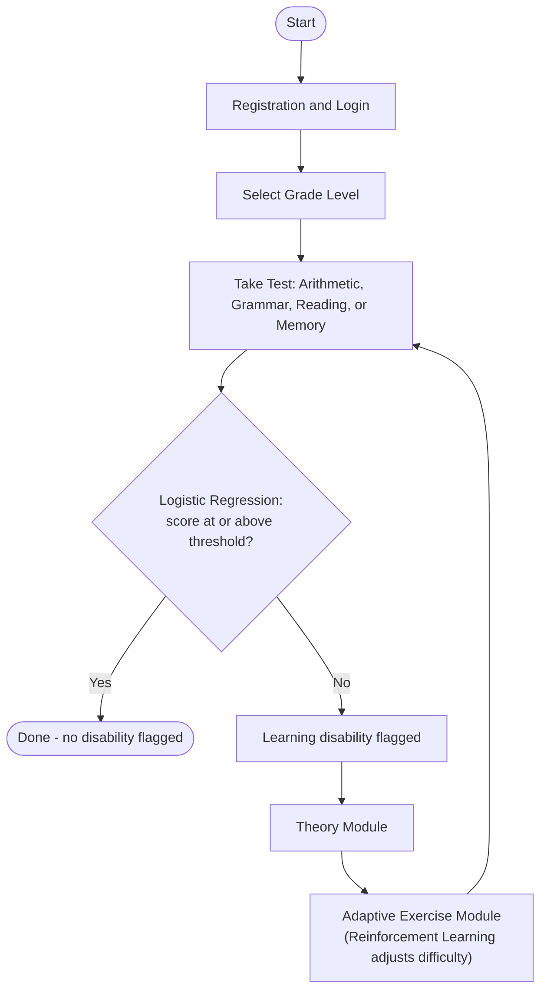

# 🧠 Learning Ability Enhancement System

**a.k.a. SuperLearn** — an ML-powered platform that detects potential learning disabilities in school students and helps them improve through personalized, adaptive practice.

[](https://reactjs.org/)
[](https://nodejs.org/)
[](https://www.mongodb.com/)
[](https://scikit-learn.org/)
[]()

A B.Tech capstone project from the Department of Computer Science & Engineering, JNTU-GV College of Engineering, Vizianagaram (A) — 2021–2025.

---

## Table of Contents

- [Overview](#overview)
- [Problem Statement](#problem-statement)
- [Key Features](#key-features)
- [System Architecture](#system-architecture)
- [Machine Learning Approach](#machine-learning-approach)
- [Tech Stack](#tech-stack)
- [Project Structure](#project-structure)
- [Getting Started](#getting-started)
- [Usage](#usage)
- [Dataset](#dataset)
- [Core Implementation Snippets](#core-implementation-snippets)
- [Testing](#testing)
- [Screenshots](#screenshots)
- [Future Scope](#future-scope)
- [Team](#team)
- [Acknowledgements](#acknowledgements)
- [References](#references)
- [License](#license)

---

## Overview

Learning disabilities affect how a student processes, interprets, and responds to information — not their intelligence. Left undetected, they can quietly erode a child's confidence and academic progress for years.

**Learning Ability Enhancement System (LAES)** — shown in-app as **SuperLearn** — is a full-stack web platform that makes early detection fast, objective, and accessible. Students take four short, grade-appropriate assessments (**Arithmetic, Grammar, Reading, and Memory**), and a **Logistic Regression** model classifies whether a learning disability is likely present. Students who are flagged move through a targeted **Theory Module** and then an **Adaptive Exercise Module**, where **Reinforcement Learning** continuously tunes question difficulty to match their performance in real time.

## Problem Statement

Traditional identification of learning disabilities depends on manual teacher observation and standardized testing — a process that is slow (often weeks or months), subjective, inconsistent across schools, and largely inaccessible outside urban centers with specialist access. By the time a disability is identified, a student may already have fallen behind academically and lost confidence.

LAES replaces this with a structured, repeatable digital assessment that any student with an internet connection can take, with results classified instantly by a machine learning model instead of a multi-week manual evaluation.

## Key Features

- **Grade-adaptive Arithmetic Test** (Grades 1–7) — addition, subtraction, multiplication, division, fractions, decimals, and word problems, randomized and timed
- **Grammar Test** — parts of speech, tenses, punctuation, sentence correction, singular/plural forms, and vocabulary
- **Reading Test with speech-to-text** — uses the Web Speech API / Google Speech API to score pronunciation, word recognition, and fluency
- **Memory Games** — Digit Span, Pattern Recall, Word Recall, and Picture Memory (identical across all grade levels)
- **ML-based disability classification** — Logistic Regression flags a potential learning disability from the four subject scores
- **Adaptive Exercises** — Reinforcement Learning raises or lowers question difficulty after every response
- **Theory Module** — targeted concept refreshers before a student retries an exercise
- **Progress tracking** — test history (score, subject, date) stored per user and shown on login
- **Accessibility-first reading support** — speech-to-text helps students with dyslexia or reading difficulty engage with the test on equal footing

## System Architecture



Each of the four subject tests follows this same loop independently: **assess → classify → (if flagged) learn → practice adaptively → reassess**, until the student's score clears the mastery threshold (70% in the reference implementation).

## Machine Learning Approach

**Disability classification — Logistic Regression**

| Step | Description |
|---|---|
| Input | Arithmetic, Grammar, Reading, and Memory scores (each out of 25) |
| Preprocessing | Normalization and distribution transformation of raw scores |
| Model | Weighted linear combination → sigmoid activation → probability |
| Output | Threshold at 0.5 → `1` (learning disability detected) or `0` (no disability detected) |

Logistic Regression was chosen over more complex models for its interpretability, efficiency on a comparatively small dataset, and lower overfitting risk.

**Adaptive difficulty — Reinforcement Learning**

The exercise module treats each subject as an environment where the next question's difficulty is the action:

- Correct answer → next question gets harder
- Incorrect answer → next question gets easier, with hints/explanations shown

This keeps practice challenging without becoming discouraging, and applies uniformly across all four adaptive exercise modules.

## Tech Stack

| Layer | Technology |
|---|---|
| Frontend | React.js, HTML5, CSS3, JavaScript, Framer Motion |
| Backend | Node.js |
| Database | MongoDB |
| Speech Recognition | Web Speech API / Google Speech API |
| Machine Learning | Python, scikit-learn, NumPy, Pandas |
| Icons | Font Awesome |

## Project Structure

> Suggested layout based on the modules described in the project report — rename paths to match your actual repository.

```
learning-ability-enhancement-system/
├── client/                        # React frontend
│   ├── src/
│   │   ├── components/
│   │   │   ├── Form/               # Registration & login
│   │   │   ├── ArithmeticTest/
│   │   │   ├── GrammarTest/
│   │   │   ├── ReadingTest/         # HTML + Web Speech API
│   │   │   ├── MemoryGame/
│   │   │   │   ├── DigitSpan/
│   │   │   │   ├── PatternRecall/
│   │   │   │   ├── WordRecall/
│   │   │   │   └── PictureMemory/
│   │   │   ├── Theory/
│   │   │   └── AdaptiveExercise/
│   │   ├── App.js
│   │   └── index.js
│   └── package.json
├── server/                        # Node.js backend
│   ├── models/                     # Mongoose schemas (User, TestResult, ...)
│   ├── routes/
│   ├── controllers/
│   ├── server.js
│   └── package.json
├── ml/                             # Scoring & adaptive-difficulty logic
│   ├── logistic_regression.py
│   ├── reinforcement_learning.py
│   └── requirements.txt
├── docs/
│   └── Learning_Ability_Enhancement_System_Report.pdf
└── README.md
```

## Getting Started

### Prerequisites

- Node.js v16+ and npm
- MongoDB (local instance or MongoDB Atlas)
- Python 3.x + pip (for the ML scoring / adaptive-difficulty service)
- A browser with microphone access — Chrome is recommended for Web Speech API support in the Reading Test

### Installation

```bash
# 1. Clone the repository
git clone https://github.com/<your-username>/learning-ability-enhancement-system.git
cd learning-ability-enhancement-system

# 2. Install frontend dependencies
cd client
npm install

# 3. Install backend dependencies
cd ../server
npm install

# 4. (Optional) Install the ML service dependencies
cd ../ml
pip install -r requirements.txt
```

### Environment Variables

Create a `.env` file inside `server/`:

```env
MONGODB_URI=your_mongodb_connection_string
PORT=5000
SPEECH_API_KEY=your_google_speech_api_key   # only needed if using Google Speech API instead of the browser's built-in Web Speech API
```

### Running the App

```bash
# Terminal 1 — backend
cd server
npm start

# Terminal 2 — frontend
cd client
npm start
```

The frontend runs at `http://localhost:3000`, calling the API at `http://localhost:5000`.

## Usage

1. **Register** with name, age, grade level (1st–7th), email, phone number, and school name.
2. **Log in** to see your test category selection and past test history.
3. **Take a test** — Arithmetic, Grammar, and Reading questions are generated for your grade level; the Memory Game is the same for everyone.
4. The system scores your attempt and runs it through **Logistic Regression**.
   - Score at/above threshold → done, no disability flagged for that subject.
   - Score below threshold → flagged, and you're routed into the **Theory Module**.
5. After the theory content, you enter the **Adaptive Exercise Module**, where question difficulty adjusts after every answer via **Reinforcement Learning**.
6. Retake the test after practicing — the system tracks each attempt so you (and, in a classroom setting, a teacher) can see improvement over time.

## Dataset

The classifier is trained on four subject scores plus a binary label:

| Field | Description | Range |
|---|---|---|
| Arithmetic Score | Score on the arithmetic test | 0–25 |
| Grammar Score | Score on the grammar test | 0–25 |
| Reading Score | Score on the reading test | 0–25 |
| Memory Score | Score on the memory test | 0–25 |
| Learning Disability Label | Target variable | `0` = no disability, `1` = disability detected |

## Core Implementation Snippets

The following excerpts are from the project's implementation chapter and illustrate how each test module generates and grades its questions.

### Arithmetic Test — question generation (React)

> Shown as it appears in the project report, where the code block was truncated before the closing braces.

```jsx
import React, { useState, useEffect } from "react";
import { useNavigate } from "react-router-dom";
import { motion } from "framer-motion";
import "./Quiz.css";

const generateUniqueQuestions = () => {
  const types = ["addition", "subtraction", "moreLess", "shapes"];
  const questionsSet = new Set();

  while (questionsSet.size < 25) {
    const type = types[Math.floor(Math.random() * types.length)];
    let num1, num2, question, answer, options, shapeType;

    switch (type) {
      case "addition":
        num1 = Math.floor(Math.random() * 11) + 1;
        num2 = Math.floor(Math.random() * 11) + 1;
        question = `What is ${num1} + ${num2}?`;
        answer = num1 + num2;
        break;

      case "subtraction":
        num1 = Math.floor(Math.random() * 11) + 10;
        num2 = Math.floor(Math.random() * (num1 - 1)) + 1;
        question = `What is ${num1} - ${num2}?`;
        answer = num1 - num2;
        break;

      case "moreLess":
        num1 = Math.floor(Math.random() * 20) + 1;
        num2 = Math.floor(Math.random() * 20) + 1;
        question = `Is ${num1} ____ ${num2}?`;
        answer = num1 > num2 ? ">" : "<";
        options = [">", "<"];
        break;

      case "shapes":
        const shapeNames = ["Circle", "Square", "Triangle", "Rectangle"];
        shapeType = shapeNames[Math.floor(Math.random() * shapeNames.length)];
        question = "What shape is shown below?";
        answer = shapeType;
        options = shapeNames;
        break;

      default:
        continue;
    }
    // ...question is added to questionsSet and returned (see full source)
  }
};
```

### Grammar Test — question generation (React)

```jsx
import React, { useState, useEffect } from "react";
import { useNavigate } from "react-router-dom";
import { motion } from "framer-motion";
import "./Quiz.css";

const getRandomElement = (arr) => arr[Math.floor(Math.random() * arr.length)];

const vowels = ["A", "E", "I", "O", "U"];
const consonants = [
  "B", "C", "D", "F", "G", "H", "J", "K", "L", "M",
  "N", "P", "Q", "R", "S", "T", "V", "W", "X", "Y", "Z",
];
const alphabet = [...vowels, ...consonants];

const singularPluralPairs = [
  { singular: "cat", plural: "cats" },
  { singular: "dog", plural: "dogs" },
  { singular: "bus", plural: "buses" },
  { singular: "baby", plural: "babies" },
  { singular: "fox", plural: "foxes" },
];

const generateQuestions = () => {
  let questions = [];
  let answers = [];

  for (let i = 0; i < 25; i++) {
    let type = i % 4;
    let question = "";
    let correctAnswer = "";

    switch (type) {
      case 0: {
        let vowel = getRandomElement(vowels);
        question = `Which of the following is a vowel? ${getRandomElement(alphabet)}, ${getRandomElement(alphabet)}, ${vowel}`;
        correctAnswer = vowel;
        break;
      }
      case 1: {
        let consonant = getRandomElement(consonants);
        question = `Which of the following is a consonant? ${getRandomElement(alphabet)}, ${getRandomElement(alphabet)}, ${consonant}`;
        correctAnswer = consonant;
        break;
      }
      case 2: {
        let singularPair = getRandomElement(singularPluralPairs);
        question = `What is the plural of "${singularPair.singular}"?`;
        correctAnswer = singularPair.plural;
        break;
      }
      case 3: {
        let pluralPair = getRandomElement(singularPluralPairs);
        question = `What is the singular form of "${pluralPair.plural}"?`;
        correctAnswer = pluralPair.singular;
        break;
      }
      default:
        break;
    }

    questions.push(question);
    answers.push(correctAnswer);
  }
  return { questions, answers };
};
```

### Reading Test — markup (HTML + Web Speech API)

```html
<div class="container">
  <h2>Reading Test</h2>
  <div class="progress-container">
    <div class="progress-bar" id="progressBar"></div>
  </div>
  <p id="questionCounter">Sentence 1 of 10</p>
  <p id="sentenceDisplay" class="sentence"></p>

  <div id="recognizedText">Waiting for your speech...</div>
  <div id="feedback" class="hidden"></div>

  <div class="button-container">
    <button id="startSpeaking" class="button" onclick="startSpeechRecognition()">
      Start Speaking
      <span id="listeningIndicator" class="listening-indicator hidden"></span>
    </button>
    <button id="skipButton" class="button secondary" onclick="nextSentence()">Skip Sentence</button>
  </div>

  <div id="resultsSection" class="hidden">
    <p id="scoreDisplay"></p>
    <div class="button-container">
      <button id="replayAudio" class="button" onclick="playTestSentences()">Listen to Correct Sentences</button>
      <button id="retryTest" class="button secondary" onclick="restartTest()">Retry Test</button>
      <button id="goToExercise" class="button tertiary hidden" onclick="window.location.href='speecher1.html'">Go to Exercises</button>
      <button id="saveResultsBtn" class="button" onclick="saveResults()">
        Save Results
        <span id="saveLoading" class="loading hidden"></span>
      </button>
    </div>
  </div>
</div>
```

### Memory Test — Digit Span markup (HTML)

```html
<!DOCTYPE html>
<html lang="en">
<head>
  <meta charset="UTF-8" />
  <meta name="viewport" content="width=device-width, initial-scale=1.0" />
  <title>Digit Span Test</title>
  <link rel="stylesheet" href="digit_span.css" />
  <link rel="stylesheet" href="https://cdnjs.cloudflare.com/ajax/libs/font-awesome/6.0.0-beta3/css/all.min.css" />
</head>
<body>
  <h1>Digit Span Memory Test</h1>
  <p>Select Difficulty Level</p>

  <div id="difficulty-selection">
    <button onclick="selectDifficulty('easy')">Easy</button>
    <button onclick="selectDifficulty('medium')">Medium</button>
    <button onclick="selectDifficulty('hard')">Difficult</button>
  </div>

  <div id="game-section" style="display: none;">
    <h2 id="level-title"></h2>
    <div id="sequence-container"></div>

    <div id="input-container" style="display: none;">
      <input type="text" id="user-input" placeholder="Enter the sequence" />
      <button onclick="checkSequence()">Submit</button>
    </div>

    <button id="start-button" onclick="startTest()">Start Test</button>
    <button id="retry-button" onclick="retryLevel()" style="display: none;">Retry</button>
    <button id="next-button" onclick="nextLevel()" style="display: none;">Next Level</button>

    <p id="result" class="result-message"></p>
  </div>

  <a href="index.html" class="back-link">Back to Home</a>
  <script src="digit_span.js"></script>
</body>
</html>
```

## Testing

**Form validation**

| Test case | Input | Expected outcome |
|---|---|---|
| Valid user details | Name, Age, Grade, Email, Phone, School | Submission successful |
| Invalid email format | `user@com` | "Invalid email format" |
| Missing required fields | One or more fields left empty | "Please fill all required fields" |

**Test assessment**

| Test case | Input | Expected outcome |
|---|---|---|
| Correct answer | User selects the correct answer | Score increases |
| Incorrect answer | User selects a wrong answer | Score stays the same |
| Timer expiry | No answer within the time limit | Question auto-submits |
| Skipped question | No option selected | Advances to next question |
| Clear pronunciation | Sentence spoken correctly | Speech converted to text accurately |
| Mispronounced words | Sentence spoken incorrectly | System flags the incorrect words |
| Full score submission | Arithmetic, grammar, reading, memory scores | Model predicts disability status |

**Adaptive exercise module**

| Test case | Input | Output |
|---|---|---|
| Correct answers | User answers correctly | Next question is harder |
| Incorrect answers | User answers incorrectly | Easier question shown |
| Unauthorized access | Attempt to view results without login | Access denied |

## Screenshots

> Add your screenshots to `assets/screenshots/` (filenames below are suggestions matching Figures 6.1–6.21 in the project report) and the images will render here.

| | |
|---|---|
|  Home page |  Registration form |
|  Login & test history |  Test categories |
|  Arithmetic test |  Arithmetic test result |
|  Grammar test |  Theory module |
|  Reading test |  Reading test result |
|  Memory game categories |  Digit span game |

## Future Scope

- [ ] AI-driven, fully personalized study plans
- [ ] Native mobile app (iOS/Android)
- [ ] VR/AR-based memory and focus exercises
- [ ] Pilot integration with school curriculums for classroom-scale use

## Team

| Name | Roll No. |
|---|---|
| Maddu Prasanna | 21VV1A0526 |
| Konisa Sai Sriyuktha | 21VV1A0524 |
| Oleti Anand Sai | 21VV1A0536 |
| Shaik Shamsunnisa | 21VV1A0550 |

**Guide:** Sri R.D.D.V Sivaram Rolangi, Assistant Professor, Dept. of CSE, JNTUGV-CEV(A)

## Acknowledgements

Developed as a B.Tech capstone project (2021–2025) under the Department of Computer Science & Engineering, JNTU-GV College of Engineering, Vizianagaram (A), with guidance from **Sri R.D.D.V Sivaram Rolangi** and support from **Dr. P. Aruna Kumari** (HOD, CSE) and **Prof. R. Rajeswara Rao** (Principal).

The full academic report — including the literature survey, detailed methodology, and result screenshots — is available at [`docs/Learning_Ability_Enhancement_System_Report.pdf`](docs/Learning_Ability_Enhancement_System_Report.pdf).

## References

1. Dombrowski, S. C. (2020). *Learning Disabilities*. In Psychoeducational Assessment and Report Writing (pp. 221–289). Springer International Publishing. DOI: 10.1007/978-3-030-44641-3_12
2. Odell, J. D. (2020). *Learning Disabilities*. In Medical Treatment of ADHD (pp. 53–64). Routledge. DOI: 10.4324/9781003046349-5
3. Sivalingam, M., & Venkateswaran, R. (2024). A Systematic Review on Specific Learning Disability among School Students. *Journal of the Indian Academy of Applied Psychology*, Special Issue, 147–155.
4. Gautam, A. (2023). Learning Disability among School Children: Role of Psychological Intervention. *The International Journal of Indian Psychology*, 11(3).
5. David, J. M., & Balakrishnan, K. (2020). Machine Learning Approach for Prediction of Learning Disabilities in School-Age Children. *International Journal of Computer Applications*, 9(11). DOI: 10.5120/1432-1931
6. Mary, M. T., Hanumanthappa, M., & Sangamithra, A. (2019). Intelligent Predicting Learning Disabilities in School Going Children Using Fuzzy Logic K-Mean Clustering in Machine Learning. *International Journal of Recent Technology and Engineering (IJRTE)*, 8(4).

## License

Add a license of your choice before open-sourcing this repository (MIT is a common, permissive option for academic projects). See [choosealicense.com](https://choosealicense.com/) for guidance.
